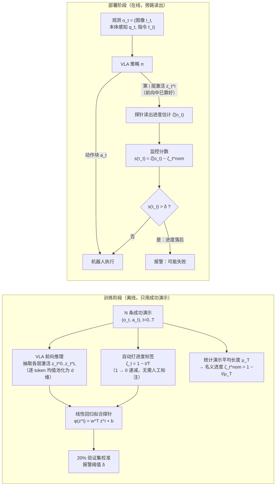

```alert
type: info
icon: lucide:microscope
title: 全文精读 · AI 完成，待本人定稿
本文基于论文 PDF 全文（arXiv:2610.31613v1）完成五段式精读：整体理解、架构、数学推导、工程笔记、批判性分析均已补全，公式与数字逐一对照正文与表格核对。分析由 AI 完成、不代表论文作者观点，最终定稿以本人审读为准；转述如有出入，以论文原文为准。
```

## 论文信息与审读进度

| 阶段 | 状态 |
| --- | --- |
| 摘要级综述 | ✅ 已完成 |
| 方法细节推导（正文精读） | ✅ AI 已完成（Sec. III–V 逐式核对） |
| 实验与消融核对 | ✅ AI 已完成（Table I–IV、Fig. 2–5） |
| 本人审读定稿 | ⏳ 待完成 |
| 复现 | ⏳ 计划已列，待执行 |

## 1. 整体理解：这篇论文在回答什么问题

VLA 模型（π0.5、GR00T 这一代）已经能从视觉观测 + 语言指令直接输出操作动作，但**失败是突发且难以预测的**：论文引言列举了语言落地错误、死锁、操作失误等失败模式。无人盯守地部署，必须有运行时监控器（runtime monitor）在策略跑偏时发现并喊停。

现有监控器的差异主要在**信号来源**（论文 Sec. II 的分类）：

- **外部评判员**：Sentinel 用外部 VLM + 动作一致性启发式判断策略是否停滞；Robometer 这类通用奖励模型从大规模机器人视频数据学习评估任务进度。问题是推理循环里多了一个大模型——复杂、贵、判断频率跟不上控制频率；
- **偏离成功分布**：FIPER、FAIL-Detect 对观测或策略输出做异常检测，标记偏离成功执行分布的样本；
- **策略内部信号**：SAFE 直接在策略激活上训练失败分类器——但需要专门采集**失败轨迹**做监督。

这篇论文问的是一个更底层的问题：**VLA 自己的内部激活，是否已经携带了监控所需的信息？** 依据是 VLA 机制可解释性的近期结果——VLM backbone 的激活里可以线性解码出末端位姿、物体状态、任务阶段等特征。作者的假设（Sec. I）：激活同样编码了**任务进度**（task progress）；成功执行中这个进度随时间可预测地推进，失败执行中解码出的进度会**落后于流逝的时间**。

于是方法可以轻到极致：在成功演示上训练一个线性探针（linear probe）回归任务进度，部署时比较「探针读出的进度」与「正常执行此刻应有的进度」，落后超阈值就报警。两个工程上诱人的性质随之而来（Sec. V）：

1. **免失败数据**——进度标签在成功数据上单调变化，可以无人工监督地自动标注，探针只需成功演示即可训练；
2. **几乎零开销**——探针读的是推理前向过程中**本来就要算**的激活，一次内积的代价。摘要声称比外部基础模型监控器快 5× 到 20,000×。

这和 LLM 可解释性中「线性表征假设」（高层概念是激活空间中的方向）以及「用简单探针读出模型内部状态」的研究是一脉相承的——论文 Sec. II 明确把自己定位在这条线上，把同样的工具搬到了具身策略上。

## 2. 架构：训练期与部署期的完整流水线

论文研究对象是 π0.5（VLM backbone 为 3B 的 PaliGemma，transformer 架构）。整条流水线如下（对照论文 Fig. 1 与 Sec. III/V 归纳，非论文原图）：



几个结构上的要点：

- **激活从哪里来**：观测序列 tokenize 后经过 $L$ 层 transformer block，每层残差流激活形状为 $d \times k$（$k$ 为 token 数），**对 token 做均值池化**得到 $d$ 维向量（论文脚注 1）。探针作用在单层激活上；
- **监控是旁路，不是额外模型**：部署时唯一新增的计算是一次 $d$ 维内积 + 一次减法 + 一次阈值比较；
- **训练全程无人工标签**：进度标签来自时间归一化，失败数据完全不需要；报警阈值 $\delta$ 在 20% 验证切分上按 FIPER 的流程校准（Sec. VI Training）。

需要注意的一个缺口：**正文没有写明最终监控用的是哪一层 $i$、按什么流程选层**——公式对任意层成立，但部署层号与选层消融未在正文给出（详见第 5 节批判性分析）。

## 3. 数学：从概率形式化到监控分数

本节把论文 Sec. III–V 的数学串成一条线，每个变量给出含义。

### 3.1 对象与记号（Sec. III）

VLA 策略记为 $\pi(\mathbf{a}_t \mid o_t)$：

- $\mathbf{a}_t = (a_t, \dots, a_{t+h}) \in \mathcal{A}^h$ —— $h$ 步**动作块**（action chunk）；
- $o_t = (I_t, q_t, \ell_t)$ —— 观测，由图像 $I \in \mathcal{I}$、本体感知 $q \in \mathcal{Q}$、语言指令 $\ell \in \mathcal{L}$ 组成。

transformer 的残差流逐层更新：

$$
z^{i+1} = z^i + f^i(z^i), \qquad i \in \{0, \dots, L-1\}
$$

其中 $z^i \in \mathbb{R}^d$ 是第 $i$ 层激活（token 维已均值池化），$f^i: \mathbb{R}^d \to \mathbb{R}^d$ 是第 $i$ 层的残差函数，$L$ 为层数，$d$ 为激活维度。

线性探针是从激活到目标特征 $\zeta \in \mathbb{R}$ 的仿射映射：

$$
\phi(z^i) = \mathbf{w}^{\top} z^i + b, \qquad \mathbf{w} \in \mathbb{R}^d, \; b \in \mathbb{R}
$$

$\mathbf{w}, b$ 是探针的全部可训练参数（实验中约 2K 个，对应 $d$ 维权重加偏置）。

### 3.2 运行时监控的形式化（Sec. IV，沿用 Sentinel 的有限时域设定）

- $\tau_t = (o_0, a_0, \dots, o_t)$ —— 截至时刻 $t$ 的观测-动作轨迹；
- $H$ —— 最大任务时域（horizon）；
- $Y \in \{0, 1\}$ —— rollout 结局：$H$ 步内到达成功状态则 $Y=1$，否则 $Y=0$；
- 监控器 $s(\tau_t) \in \mathbb{R}$ —— 把轨迹映射为标量，值越大表示越偏离成功/名义数据；
- 给定阈值 $\delta \in \mathbb{R}$，**检测时刻** $T_\delta = \inf\{t \mid s(\tau_t) > \delta\}$，监控器从不报警则 $T_\delta = \infty$。

设计目标是一个多目标优化（论文 Eq. 1）：

$$
\min_s \; \mathbb{E}_\tau \big[ \mathrm{FPR}(\delta, \tau; s) + \lambda \cdot \mathrm{DetectTime}(\delta, \tau; s) \big]
$$

- $\mathrm{FPR}(\delta, \tau; s) = P(T_\delta \le H \mid Y = 1)$ —— **误报率**：成功轨迹上监控器在时域内报了警的概率；
- $\mathrm{DetectTime}(\delta, \tau; s) = \mathbb{E}[T_\delta \mid Y = 0, T_\delta \le H]$ —— 失败轨迹上的**平均检测时刻**（越早越好）；
- $\lambda > 0$ —— 平衡两个目标的权重。

即：少误报成功执行，同时对失败尽早报警。

### 3.3 进度标签与探针训练（Sec. V）

对一条长度 $T \le H$ 的成功轨迹 $\tau = (o_0, a_0, \dots, o_T)$，每个观测的进度标签取**归一化剩余时间**（论文 Eq. 2）：

$$
\zeta_t = 1 - \frac{t}{T}
$$

$\zeta_t$ 从任务开始时的 1 单调递减到结束时的 0——**值越大表示越靠近任务开头**。这个定义使标签完全由时间戳决定，无需人工标注，也是「只需成功数据」的来源。

把 $N$ 条成功演示全部喂给 VLA、抽取各层激活，得到探针训练集（论文 Eq. 3）：

$$
\mathcal{D}_{\mathrm{probe}} = \{ (z_t^{0,n}, z_t^{1,n}, \dots, z_t^{L,n}, \; \zeta_t^n) \}_{n=1,\dots,N;\; t=0,\dots,T^n}
$$

其中 $z_t^{i,n}$ 是第 $n$ 条轨迹时刻 $t$ 第 $i$ 层的激活，$T^n$ 是第 $n$ 条轨迹的长度。探针用普通线性回归训练，预测为

$$
\hat{\zeta}(o) = \phi(z^i)
$$

即观测 $o$ 输入 VLA 后取第 $i$ 层激活过探针。

### 3.4 从探针到监控分数（Sec. V）

记 $N$ 条成功演示的平均长度

$$
\mu_T = \frac{1}{N} \sum_{n=1}^{N} T^n
$$

则名义（nominal）执行在时刻 $t$ 的期望进度为 $\zeta_t^{\mathrm{nom}} = 1 - t/\mu_T$。监控分数就是估计进度对名义进度的偏差（论文 Eq. 4）：

$$
s(\tau_t) = \hat{\zeta}(o_t) - \zeta_t^{\mathrm{nom}}
$$

由于 $\zeta$ 越大越靠近开头，$s > 0$ 表示**估计进度落后**于名义轨迹，$s < 0$ 表示超前。论文明确**不惩罚执行偏快**，只在落后足够多（$s(\tau_t) > \delta$）时判为可能失败。这个单边设计是把「失败 = 进度停滞/倒退」作为核心失败假说的直接体现——它的代价在第 5 节讨论。

## 4. 工程笔记：复现要盯的细节

从论文 Sec. VI/VII 的实验配置里抠出的、复现时真正要对齐的东西：

**数据与训练规模**

- 仿真：π0.5 在 VLABench 上用 5,000 条轨迹微调（10 任务 × 500 条）；监控只在其中 **6 个成功率非可忽略的任务**上评估。探针数据 $N = 300$ 条成功轨迹（6 任务 × 50 条），80/20 训练/验证切分，验证集同时用于**按 FIPER 的流程校准阈值 $\delta$**；
- 真机：Franka Research 3 + DROID 相机配置，π0.5-DROID checkpoint 在 6 个自建任务上微调（每任务 60 条、共 360 条，来自 StressDream）；探针数据直接复用这 360 条微调轨迹过策略后的激活，同样 80/20 切分；
- 真机任务清单（Sec. VII）：Candy Bag、Coffee Bag、Coffee Bean（倒咖啡豆）、Knife Put、Block Stack、Stacked Utensil——全部是单臂桌面操作，含防洒、堆叠等约束。

**评估协议**

- 仿真 600 条 rollout（每任务 100 条）、真机 120 条（每任务 20 条），成功/失败各半；
- 失败 rollout 由人工标注失败发生的时间步，其后全部帧记为失败，用于 **state 级**（逐帧分数判别）评估；**episode 级**取整条轨迹的最大监控分数做判别。两级都报 AUROC；
- 检测时间评估：报 TPR@5%FPR 随 episode 进度（25/50/75/100%）的曲线，检测时间以 episode 占比计。

**开销（作者声称，RTX A6000 实测）**

- P² 推理延迟 **2.6×10⁻² ms**，是全部基线中最低：比同为特征级的 SAFE-MLP（1.2×10⁻¹ ms）、SAFE-LSTM（1.8×10⁻¹ ms）快约一个量级，比 4B 的 Robometer（5.5×10² ms，10 帧上下文）快**一万倍以上**；
- 可训练参数约 **2K**（一个 $d$ 维线性头），对比 Robometer-FT 微调 4B 参数。

**实现细节与正文留白**

- 激活形状 $d \times k$，**逐 token 均值池化**成 $d$ 维（脚注 1）——复现时池化方式必须对齐；
- 探针挂在 VLM backbone 的激活上，**不含动作专家**（扩散/流匹配头）的内部状态——这是作者自列的局限之一；
- **正文未写明**：最终监控用第几层激活、选层依据（逐层 R²/AUROC 消融未出现在正文）；多任务时名义进度的 $\mu_T$ 是否按任务分别统计也未明说。复现时这两处需要自己做 sweep 并以验证集定。

## 5. 批判性分析

### 5.1 结果到底有多强（数字全部为作者声称）

仿真（Table I，全任务）：P² episode AUROC **0.909** / state **0.788**。要点是对照组：

- 用了失败标签的 SAFE-MLP 更高（0.930 / 0.894）；**不用**失败标签的特征级基线 FAIL-Detect (logpZ0) 在全任务上也更高（0.904 / 0.888）。所以在「见过的任务」上，P² 并非最强，论文用词「competitive」是准确的；
- 但在**未见任务**上形势反转：P² episode **0.900** / state **0.794**，几乎没掉点；FAIL-Detect (logpZ0) 崩到 0.634 / 0.571，SAFE 靠失败标签撑住（0.896 / 0.866）。**免失败数据的方法里，跨任务泛化 P² 一枝独秀**——这是全文最有分量的结果；
- 真机（Table III/IV）：全任务 state 级平均 AUROC **0.78**、未见任务 **0.81**，均为所有方法最高；episode/state 两级都超过 Robometer-FT 与 SAFE（Fig. 4）。

消融（Sec. VI-C）回答了「为什么是 VLA 的激活」：同一探针训练流程下，π0.5 激活的进度回归 R² = 0.83、监控 AUROC = 0.93，高于其 VLM 底座 PaliGemma（0.69 / 0.88）和看过机器人视频的 Robometer-ZS（0.63 / 0.61）、Robometer-FT（0.76 / 0.81）。作者假设是**动作预测的训练目标**塑造了更利于判断执行状态的内部表征——「见过机器人图像」不够，「学过出动作」才行。这个结论若能跨模型族复验，对 VLA 表征研究是独立有价值的。

### 5.2 方法内生的盲区

- **进度 = 线性时间的假设**。$\zeta_t = 1 - t/T$ 假设进度随归一化时间匀速推进，$\zeta_t^{\mathrm{nom}}$ 进一步用单一平均长度 $\mu_T$ 刻画名义执行。对耗时方差大、含合法等待（如等物体稳定）或多阶段速度不均的任务，正常执行也会积累偏差。真机每任务只有 60 条演示，$\mu_T$ 的估计方差不小；
- **单边分数漏掉一类失败**。$s > \delta$ 只罚落后。若失败不表现为「表观进度停滞」——典型如 Coffee Bean 任务里随机性的洒豆：动作仍在分布内、图像变化细微——探针无从报警。该任务 P² 的 state AUROC 只有 **0.26**（比随机还差，Table III），论文自己也承认「激活变化可能不足以提供失败信号」。换句话说，**P² 检测的是『执行卡住/跑偏』这一类失败，不是全部失败**；
- **报警偏晚**。Table II：episode 前 25% 内 P² 的 TPR@5%FPR 为 **0.00**（SAFE-LSTM 为 0.11），平均检测时刻在 episode 的 0.60 处（SAFE-LSTM 0.53）。对「及时喊停避免损坏」的场景，这个延迟是实打实的代价——毕竟探针只看当前帧激活、没有时序模型；
- **单模型、单 backbone 的证据**。全部实验基于 π0.5（PaliGemma backbone），且只探 VLM backbone、不含动作专家——两点都是作者自列的局限（Sec. VIII），GR00T、MolmoAct 等不同架构/训练配方下结论是否成立是开放问题；
- **「泛化」的边界要读清楚**。未见任务实验是**同一本体、同一域内**的 6 选 3 留出（$\binom{6}{3} = 20$ 个切分全评），不是跨本体、跨场景泛化；而且探针依赖「该 VLA 在这些任务上被微调过、且有成功演示」这个前提。与 Robometer 零样本用法比较时，P² 其实享受了域内训练数据的优势——论文把 Robometer-FT 也拉进来对比是公平性上的正确处理，但读者不应把结果读成「探针打败了通用奖励模型」。

### 5.3 总评

这篇论文的价值不在单点 SOTA，而在把一条**极简基线**钉在了正确的位置上：VLA 激活 + 2K 参数线性探针 + 时间归一化标签，就能在免失败数据、免外部大模型的约束下，拿到与重型方案可比的失败检测质量和最好的域内跨任务泛化。对部署方，这几乎是「白捡」的监控层；对表征研究，「动作训练目标让激活携带可线性读出的执行状态」是值得独立跟进的发现。短板同样清楚：单边、无时序、假设进度匀速，决定了它该作为监控栈的**第一层**而非唯一一层——与基于动作分布或视觉异常的监控器互补使用（论文 Sec. VII 也观察到特征级与视觉线索是互补信号）。

## 6. 与站内工作的关系

- 实验载体 π0.5 正是本站[《π 系列 VLA 原理解析》](/posts/Pi系列VLA原理解析/)中分析过的分层推理模型——本文相当于在它的内部表征上做「体检」，且结论（backbone 激活线性可读出执行状态）反过来支持了 π 系列笔记里对其表征结构的讨论；
- 同周的 [Echo（arXiv:2610.31569）](https://arxiv.org/abs/2610.31569) 把 stop/failure 信号并入动作去噪过程，与本文的外挂探针形成「内生 vs 旁路」两条技术路线：Echo 改训练、P² 不动策略只读激活。两者对照见[论文雷达 2026-W43](/research/radar/2026-w43/)。

## 7. 复现计划（待执行）

目标配置：π0.5 开源权重 + VLABench，对齐论文仿真协议（6 任务、每任务 50 条演示训探针、80/20 切分、验证集校准 $\delta$）。按正文留白与批判点设计三个验证问题：

1. **逐层 sweep**：正文未报告选层——逐层测进度回归 R² 与监控 AUROC，确认「哪一层最可读」以及层间差异有多大；
2. **名义进度的统计口径**：$\mu_T$ 全局统计 vs 按任务统计，对误报率的影响；
3. **单边 vs 双边分数**：把 $s > \delta$ 换成 $|s| > \delta$，看「超前型异常」是否贡献检测率、以多少误报为代价。

完成后结果将整理进「复现记录」板块，与论文声称值并列对照。
