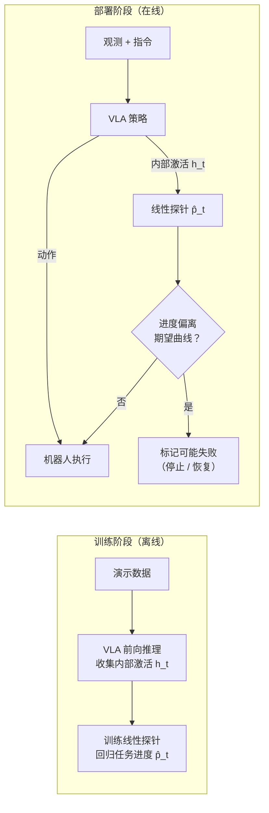

```alert
type: warning
icon: lucide:shield-alert
title: AI 分析草稿 · 待本人审读
本文由 AI 基于论文摘要与公开信息生成，属于精读的第一阶段草稿：仅「背景与问题」「方法框架」两节基于摘要展开，带 ⏳ 标记的章节尚未完成，需要精读论文正文后补全。所有分析不代表论文作者观点；转述如有出入，以论文原文为准。
```

## 论文信息与审读进度

| 阶段 | 状态 |
| --- | --- |
| 摘要级综述（本稿） | ✅ AI 草稿完成 |
| 方法细节推导（正文精读） | ⏳ 待完成 |
| 实验与消融核对 | ⏳ 待完成 |
| 本人审读定稿 | ⏳ 待完成 |
| 复现计划 | ⏳ 待完成 |

## 1. 背景与问题（AI 草稿，基于摘要）

VLA 模型已经能从视觉观测 + 语言指令直接输出操作动作，但**失败是不可预测的**：没有人盯着的情况下部署，必须有运行时监控器（runtime monitor）在策略跑偏时发现并喊停。

现有监控思路是在策略旁边再挂一个基础模型——用 VLM 看着机器人干活、判断是否失败。问题很直接：

- **复杂度**：推理循环里多了一个大模型的调用链路；
- **算力**：监控器本身可能比策略还贵；
- **延迟**：VLM 的判断频率跟不上控制频率。

这篇论文换了一个问法：**VLA 自己的内部激活，是否已经携带了监控所需的信息？** 如果答案是肯定的，监控器可以轻量到一个线性探针（linear probe）。

这个思路和 LLM 可解释性研究中「用线性探针读出模型内部状态（真话/谎话、不确定性）」是一脉相承的——把同样的工具用到了具身策略上。

## 2. 方法框架（AI 草稿，基于摘要）

摘要给出的流水线可以整理为两个阶段：



*（上图为 AI 根据摘要归纳的流程示意，非论文原图。）*

核心对象是一个线性探针。记时刻 $t$ 策略某层的内部激活为 $\mathbf{h}_t \in \mathbb{R}^d$，探针就是

$$
\hat{p}_t = \mathbf{w}^{\top}\mathbf{h}_t + b, \qquad \mathbf{w} \in \mathbb{R}^d,\; b \in \mathbb{R}
$$

其中 $\hat{p}_t$ 是估计的**任务进度**（progress），$\mathbf{w}, b$ 为探针参数，在演示数据上训练（演示中进度如何标注——均匀时间、子目标还是其它方式——需精读正文确认 ⏳）。

部署时，监控器比较 $\hat{p}_t$ 与「正常执行应有的进度」：执行长时间不涨进度、或进度曲线明显偏离期望形状，就标记为可能失败。偏差度量与报警阈值的具体定义需精读正文确认 ⏳。

两点值得注意的设计取向（AI 评注）：

1. **免失败数据**：探针只在（成功的）演示上训练，不需要专门采集失败轨迹——摘要明确把「需要失败数据训练的方法」列为被超越的基线；
2. **几乎零开销**：探针是策略前向过程的旁路读出，一次内积的代价，天然跟得上控制频率。

## 3. 实验与结论（⏳ 待精读正文核对）

摘要声称的结果（**作者声称**，本人未核对、未复现）：

- 实验载体：开源 VLA **π0.5**，覆盖仿真与真机操作任务；
- 失败检测性能：与基于 VLM 的监控器**持平或更优**；
- 同时优于需要失败数据训练的方法。

具体任务清单、检测指标（ROC/延迟）、探针挂在哪一层、对比基线的实现细节，均需精读正文后补充 ⏳。

## 4. 与站内工作的关系（AI 评注）

- 实验载体 π0.5 正是本站[《π 系列 VLA 原理解析》](/posts/Pi系列VLA原理解析/)中分析过的分层推理模型——本文相当于在它的内部表征上做「体检」；
- 同周的 [Echo（arXiv:2610.31569）](https://arxiv.org/abs/2610.31569) 把 stop/failure 信号并入动作去噪过程，与本文的外挂探针形成「内生 vs 旁路」两条技术路线，见[论文雷达 2026-W43](/research/radar/2026-w43/)。

## 5. 复现计划（⏳ 待补全）

初步想法（待精读后细化）：π0.5 开源权重 + LIBERO 一类仿真操作基准，复现探针训练与失败检测的 ROC；重点验证「不同层激活的探针质量差异」与「跨任务泛化」两个问题。本节完成后将把结果整理进「复现记录」板块，并与作者声称值并列对照。
